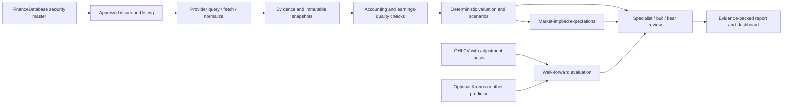

# Repository study and integration decisions

Inspected 5 November 2026. Exact commits, licenses, review scope and decisions are recorded in [the machine-readable catalog](../data/repository_catalog.json). This study reviewed READMEs, repository trees, license text and representative implementations. It did not execute the twelve upstream test suites, independently reproduce model performance claims or audit every file.

## Recommended architecture

Build a domain-owned valuation and research engine with optional providers and models. Do not make a market forecaster, an agent conversation or one vendor's response the authority for intrinsic value.

The provider boundary follows the useful separation observed in OpenBB: query specification, extraction, normalization and typed outputs. The review boundary follows the useful distinction observed in FinRobot and TradingAgents: tools calculate, specialist roles challenge evidence, and synthesis retains disagreement. Our implementation is original; it does not vendor their frameworks or claim their maturity.

## Repository-by-repository findings

| Repository | What was inspected | Use in Valuation Lab | Decision / boundary |
|---|---|---|---|
| [Kronos](https://github.com/shiyu-coder/Kronos) | README, `model/kronos.py`, MIT license | `KronosPredictor.predict` adapter; chronological forecast evaluation | Optional OHLCV forecasting experiment. No weights downloaded, neural inference run or predictive edge claimed. Model/tokenizer revisions and training overlap need separate evaluation. |
| [TradingAgents](https://github.com/TauricResearch/TradingAgents) | README, graph setup, analyst/router structure, Apache license | Seven-role research plan and explicit bull/bear/chair requirements | Adopt bounded research/challenge structure. No trade executor, broker connection or automatic agent consensus. MCP client supplies the language model. |
| [OpenBB](https://github.com/openbq-org/OpenBB) | README, abstract fetcher contract, LICENSE | Provider separation and normalized provenance envelopes | Current LICENSE text states Apache-2.0 despite GitHub metadata reporting NOASSERTION. No platform dependency installed. Individual provider entitlements remain separate. |
| [Finance](https://github.com/shashankvemuri/Finance) | README, explicit-input valuation implementation, MIT license | Explicit units and conventions; benchmark-driven forecast testing | Useful broad research examples. No optional trading/notification integrations imported. Its declared Python requirement differs from the base application's supported floor, so wholesale dependency adoption is unnecessary. |
| [FinanceDatabase](https://github.com/JerBouma/FinanceDatabase) | README, equities controller, database controller, CSV schema, compressed dataset, MIT license | Actual pinned security-master import and searchable local database | Full equities file imported locally: 121,559 records at the reviewed commit. This is a listing universe, not 121,559 independent companies or a fundamentals database. |
| [FinanceToolkit](https://github.com/JerBouma/FinanceToolkit) | README, ratio functions, forecast-evaluation code, MIT license | Transparent formula contracts, cash/earnings diagnostics and out-of-sample benchmark checks | Strong optional analysis library; not installed into the base runtime. Definitions and data-provider semantics must be reconciled before numerical cross-checks are treated as agreement. |
| [FinancePy](https://github.com/domokane/FinancePy) | README, bond pricing/convention code, GPL license | Reference for future fixed-income/derivative domain design | Do not copy GPL code into this Apache core. Future dependency/distribution decisions need an explicit license review; a separate service is not automatically a legal exemption. |
| [halessi/DCF](https://github.com/halessi/DCF) | README, `modeling/dcf.py`, repository tree | Historical DCF and assumption exploration as conceptual references | No license file found in inspected tree. No code copied or dependency introduced. Educational two-stage DCF is less complete than our core's reinvestment and validation logic. |
| [equity-research-skill](https://github.com/rollingSirius/equity-research-skill) | README, SKILL, valuation script, reference inventory, MIT license | Reverse DCF, earnings quality, expectations gap and falsifiable review tasks | Adopt research discipline with independently implemented calculations. Do not copy fixed conviction, position-sizing or buy/sell rules as universal truths. |
| [FinGPT](https://github.com/AI4Finance-Foundation/FinGPT) | README, forecaster data pipeline, MIT license | Design boundary for future financial-text extraction and supervised adaptation | No model fine-tuning or inference performed. Base-model, adapter, dataset and deployment terms must be inspected separately. Published benchmark claims were not independently reproduced. |
| [FinRobot](https://github.com/AI4Finance-Foundation/FinRobot) | README, desktop DCF operator, root/desktop Apache licenses | Deterministic valuation operators, structured reverse-solver outcomes and specialist review | The repository now contains several generations. We examined the desktop deterministic operator rather than assuming the old AutoGen examples describe the whole project. |
| [quantmod](https://github.com/joshuaulrich/quantmod) | README, `R/getSymbols.R`, GPL license | Source-aware market-data and chart workflow reference | R/GPL reference, not a Python dependency. No R runtime or code embedded. |

## Concrete additions from this study

- `instruments.py`: bounded pinned-data importer, parameterized SQL discovery, explicit exchange/country semantics and original quote currency. `ZAC` is kept distinct from `ZAR`.
- `research_engine.py`: reverse DCF for growth/margin/WACC, annual accrual and receivable diagnostics, probability-weighted cases, and seven-role research planning.
- `forecasting.py`: expanding-window random walk, drift and AR(1) evaluation, non-overlapping test folds, MAE/RMSE/benchmark skill, and an optional callback matching Kronos's inspected API.
- Dashboard: security discovery, repository catalog, additional method calculators and specialist-plan view.
- Knowledge: five additional quantitative research cards and a tenth discipline skill, linked to the reviewed repositories.
- Tests: known-value reverse solves, impossible targets, scenario basis/probability validation, quality ratios, forecast-cutoff isolation, OHLC validation, instrument currency preservation and snapshot persistence.

## What the database now contains

The local SQLite file contains the curated knowledge catalog, saved valuation runs, evidence records, provider snapshots and the pinned equities universe. The securities records are not committed to Git; another installation imports them with `python scripts/ingest_instruments.py`. The import manifest records its source URL, code commit, retrieved timestamp and compressed-source SHA-256.

The README's broader FinanceDatabase asset count spans multiple categories. This integration imports equities only. Funds, ETFs, currencies, indices and money-market catalogs are not implied by the equities count. Listing records may share an issuer, use different share classes or represent depositary receipts; they are not automatically eligible valuation peers.

## Model evaluation before promotion

1. Freeze code, tokenizer, model weights, data revision, adjustment basis and market calendar.
2. Record training cutoff and test contamination uncertainty. A chronological wrapper cannot undo pretraining overlap.
3. Compare against random walk/drift and a simple fitted model on untouched, representative markets and regimes.
4. Report per-horizon error, sampling uncertainty, missingness and calibration; this initial evaluator pools forecast leads and does not run statistical significance tests.
5. For any trading experiment, add executable timing, costs, slippage, delistings and survivorship controls. Forecast accuracy alone is not investment profitability.
6. Keep market-path forecasts separate from fundamental valuation. An analyst must justify any proposed change to revenue, margins, reinvestment or discount rates.

## Practical limits

This is selective architecture reuse plus an actual data integration, not twelve installed platforms. No API keys were requested, no paid APIs invoked, no model weights downloaded and no upstream claims of production readiness adopted as our own. Licenses shown are the inspected repository-level licenses; model weights and data can have additional terms.
